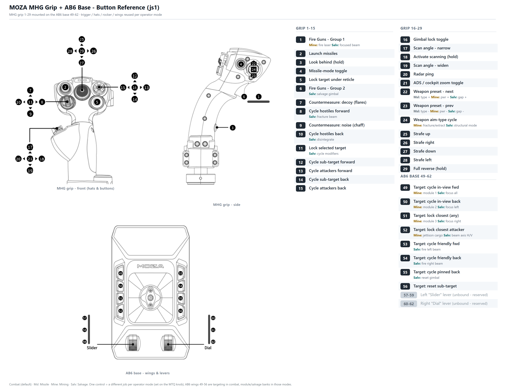
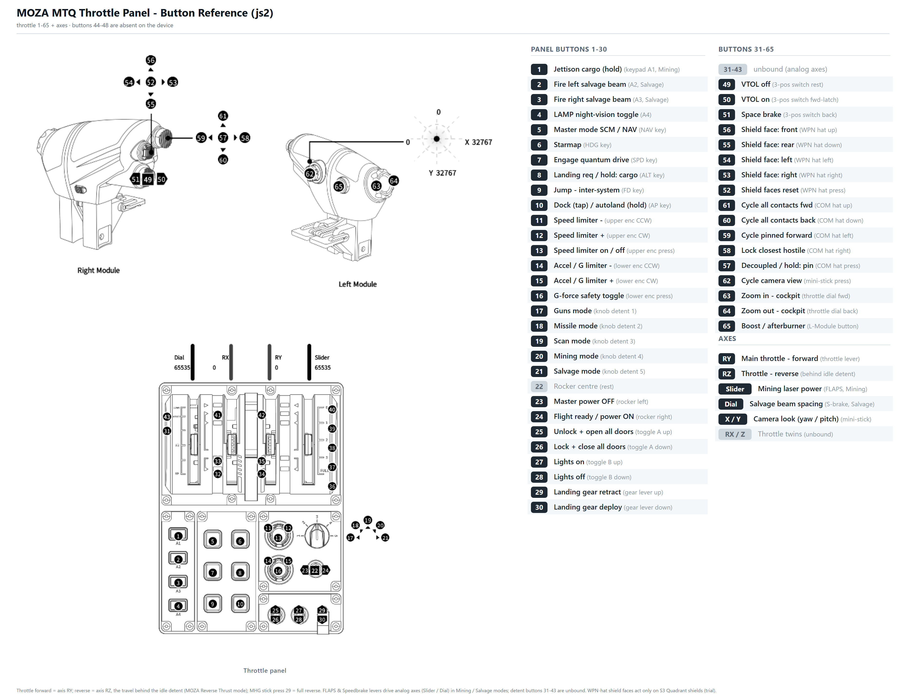

# MOZA HOTAS — Star Citizen Binding Profile

[](MOZA.xml)
[](#status)
[](https://robertsspaceindustries.com/)
[](MOZA.xml)
[](#requirements)
[](#requirements)
[](LICENSE)

This is my hand-tuned Star Citizen control-mapping profile for a **MOZA flight setup**: an MHG
grip on an AB6 FFB base, plus an MTQ throttle quadrant. The whole rig drives flight, combat,
mining, and salvage from physical controls, and I've documented and verified every binding
in-game.

> **All you actually need from this repo is [`MOZA.xml`](MOZA.xml).** Everything else is
> documentation, reference art, and the scripts that regenerate it. Jump to
> [Installing](#installing) for the two ways to put it in place.

**Folder docs** — each subfolder has its own README with the detail for what lives there:
[`diagrams/`](diagrams/README.md) · [`cards/`](cards/README.md) ·
[`reference/`](reference/README.md) · [`tools/`](tools/README.md).

---

## Requirements

This profile is tuned to one specific rig. To **use it as-is** you need:

| | Requirement | Why |
| --- | --- | --- |
| 🪟 | **Windows** | Star Citizen is Windows-only, and the profile binds devices by their **DirectInput GUIDs**. No macOS/Linux. |
| 🕹️ | **MOZA MHG grip + MOZA AB6 FFB base + MOZA MTQ Throttle Panel** | Every binding maps to these exact devices. On different hardware the device GUIDs won't match and the bindings land nowhere. |
| 🚀 | **Star Citizen** (validated against **Alpha 4.10.3**, build `4.10.201.48085`) | Action names (`v_*`) are CIG's; a major patch can rename or remove some. |
| ⚙️ | **MOZA Cockpit** configurator | A few device-side settings are assumed: the MTQ's throttle detent mode set to **Reverse Thrust** and calibrated (so the travel behind the idle detent is a proportional reverse axis, and the Idle point sits just forward of the detent so the forward throttle reads zero at rest), the MTQ **Flaps and Speedbrake levers set to output their axis**, and the MHG's top **mini-stick in Button Mapping mode** with *Press stick to switch mode* off (so it emits buttons 25–29). The MHG and MTQ have no presets in current MOZA Cockpit, so re-check these after a MOZA update. |

> **Don't have this exact rig?** You can still read the bindings as a starting point and rebind
> to your own devices, but the GUIDs in [`MOZA.xml`](MOZA.xml) are MOZA-specific, so it won't
> load cleanly onto other hardware without editing.

Regenerating the docs and cards (not needed just to *use* the profile) takes Python 3 on
Windows, macOS or Linux (`python -m pip install -r tools/requirements.txt`), plus Chrome, Edge
or Chromium for the cards. The action catalogue and the game-data check also need the game
installed. No internet access is needed. See [`tools/`](tools/README.md).

---

## Installing

Star Citizen loads control profiles from:

```
…\StarCitizen\LIVE\user\client\0\controls\mappings\
```

The game does **not** load profiles automatically — you apply them yourself (see below).

**Option A — just the file (minimal).** Copy [`MOZA.xml`](MOZA.xml) into that folder. That's it.

**Option B — the whole repo as your mappings folder (what I do).** Clone this repo *into* the
mappings folder. The game only reads `MOZA.xml` at the root and **ignores subfolders**, so the
diagrams, cards, and tools come along harmlessly and I get the reference material right where I
fly:

```powershell
cd "…\StarCitizen\LIVE\user\client\0\controls\mappings\"
git clone https://github.com/bshehram/starcitizen-moza-hotas.git
# then copy starcitizen-moza-hotas\MOZA.xml up one level, or clone with the repo contents at the mappings root
```

**Then load it in-game**, either way:

- **Options → Keybindings → Control Profiles → Load**, or
- open the console (`` ` ``) and run `pp_rebindkeys MOZA.xml` (the file name, no path).

> **Tip:** save your profile under a custom name before loading it, so a game patch that resets
> defaults can't overwrite your work.

---

## Hardware

| Game device | Physical hardware | Buttons | Axes |
| --- | --- | --- | --- |
| `js1` | **MOZA MHG** grip on **MOZA AB6 FFB** base (one DirectInput device) | grip 1–29, base 49–62 | roll / pitch / yaw twist + 2 lever axes |
| `js2` | **MOZA MTQ** Throttle Panel | 1–65 | throttle + camera mini-stick + 2 side sliders |

The MHG grip and the AB6 base report as **one** DirectInput device (`js1`): grip buttons are
1–29, the base's buttons continue at 49–62 (there's a 30–48 gap with no physical buttons). The
MTQ throttle is a **separate** device (`js2`). The full physical-control → button-number maps
live in [`diagrams/`](diagrams/README.md).

Product GUIDs as written in the profile:

- `js1` → `MOZA AB6 FFB Base  {1002346E-0000-0000-0000-504944564944}`
- `js2` → `MOZA MTQ Throttle Panel  {1101346E-0000-0000-0000-504944564944}`

> **⚑ Ships only, by design.** On foot and in ground vehicles I play on an Xbox controller, so
> this profile binds only ship/seat contexts — there are no on-foot (`player` / `spectator`) or
> ground-vehicle bindings. The few entries in those maps are *clears*: they remove stock joystick
> defaults that the game would otherwise leave live on the stick underneath this profile.

> **⚠ Device-instance fragility.** `js1`/`js2` are assigned by the order the game enumerates USB
> devices. If Windows re-enumerates them (port change, hub, reconnect order) the two sticks can
> **swap**, and every binding points at the wrong device. If that happens, re-plug in the
> original order, or swap the `instance="1"`/`instance="2"` Product lines in the XML.

---

## Reference cards

Printable US-Letter cheat sheets (one per device), generated from the manufacturer diagrams.
Full detail and how to print in [`cards/`](cards/README.md).

| `js1` — MHG grip + AB6 base | `js2` — MTQ throttle |
| --- | --- |
|  |  |

---

## Repo layout

```
MOZA.xml            the profile the game loads — THE ONLY FILE YOU NEED (keep in root)
README.md           this file
LICENSE             MIT license
diagrams/           manufacturer button-number maps (source art) + button-index tables
cards/              generated printable cheat sheets (PNG + editable SVG)
reference/          action catalogue read from the game files (v4.10) + an HTML binding sheet
tools/              regeneration and validation scripts (run from the project root)
```

Each folder above has its own README with the details:
[`diagrams/`](diagrams/README.md) · [`cards/`](cards/README.md) ·
[`reference/`](reference/README.md) · [`tools/`](tools/README.md). (You'll also see `CLAUDE.md`
files scattered through the repo — those are working notes for the Claude AI assistant and aren't
needed by human readers.)

---

## Tooling

All run from the project root. Full usage, requirements, and gotchas are in
[`tools/`](tools/README.md).

```sh
python -m pip install -r tools/requirements.txt   # one-time setup (Pillow, plus zstandard on Python < 3.14)
python tools/gamedata.py check                    # pre-flight MOZA.xml against the installed game build
python tools/gamedata.py catalogue                # regenerate the action catalogue for a new SC patch
python tools/validate_actionmaps.py               # after loading in-game: did the game keep every binding?
python tools/regen_cards.py                       # rebuild the reference cards after a binding change
```

The first four need the game installed. The card rebuild works anywhere, including a clone
on a Mac.

---

## Status

- **XML parsing — passing.** `MOZA.xml` is well-formed (`xmllint --noout MOZA.xml` is clean):
  131 actions, each with one `<rebind>`, across 21 action maps — 121 bindings plus 10 cleared
  game defaults. The game keeps a single joystick input per action, so no action carries two.
  Buttons that appear in several maps (the trigger, rocker and stick hats) are intentional
  **operator-mode reuse** — only one of those maps is live at a time, depending on whether the
  seat is in flight, mining, or salvage mode. The AB6 base wings are a power panel that works the
  same in every mode.
- **Validated against the Alpha 4.10.3 game data.** Every action name and actionmap in the
  profile was checked against the game's own `defaultProfile.xml` for build `4.10.201.48085`
  (`python tools/gamedata.py check`): no unknown actions, none in a wrong actionmap. The action
  catalogue in [`reference/`](reference/README.md) is generated from the same file.
- **In-game testing.** The core layout was flown and verified in Alpha 4.8 (June 2026),
  including the mining-laser and salvage-spacing slider axes, confirmed in a Golem and a
  Salvation. The November 2026 changes — the 10 cleared defaults, *Docking* on the AP key,
  *Request Cargo Loading* on the ALT key and proportional reverse — were loaded in Alpha 4.10.3 and
  the game accepted every entry; proportional reverse was flown in an Avenger Titan. Docking and
  cargo loading have not been exercised yet. On 26 November the decoupled toggle moved back to the
  MTQ's COM hat press (a hold there pins the target), the AB6 wings became the power panel, the
  mining and salvage banks moved to the stick's right hat, and shield faces went on the MTQ's WPN
  hat as a trial. That version was loaded the same day and the wing power panel worked. The load
  also showed that the game keeps only one joystick input per action: a stick-press "full
  reverse" added beside the throttle's reverse axis had replaced it. Reverse is the throttle axis
  again, and the stick press now tries full reverse through a separate action. The corrected
  profile was reloaded the same day and the game's saved bindings match it exactly. That fix,
  the shield faces and the right-hat banks have not been flown yet.

> Badges are self-reported — this is my personal config repo, not a CI'd codebase. The XML
> "passing" claim is reproducible locally with the `xmllint` command above, and the game-data
> validation with the `gamedata.py` command, on any machine with the game installed.

---

## Contributing

I maintain this solo, but **PRs are welcome and I'll review them** — corrections, bindings for
other MOZA layouts, newer-patch updates, or improvements to the docs and cards. Please:

- keep [`MOZA.xml`](MOZA.xml) loading cleanly (run `xmllint --noout MOZA.xml`), and
- if you change a binding, update its inline comment in the XML and the card tables in
  `tools/regen_cards.py` (the cards aren't auto-derived from the XML — see
  [`tools/`](tools/README.md)).

Open an issue first if it's a big change, so we don't duplicate effort.

---

## License & provenance

Released under the [MIT License](LICENSE) — © 2026 Basit Shehram.

Everything here is **original work**: I built the `MOZA.xml` profile, the reference cards, the
regeneration scripts, the HTML binding sheet, and all the documentation for this repo. **No
third-party profile generator is used anywhere** — the cards are built solely by the in-repo
`tools/regen_cards.py`.

Two third-party *inputs* are **not** covered by the MIT license and remain their owners' property:

- the **manufacturer diagrams** (`diagrams/*.png`) — MOZA's own button-number art, used as the
  source layer for the cards; and
- the **action catalogue** in `reference/` — a listing of action names, labels and default
  bindings read from Star Citizen's own game data, which belongs to Cloud Imperium Games.

Star Citizen is a trademark of Cloud Imperium Games. This is an unofficial, fan-made config and
is not affiliated with or endorsed by CIG or MOZA.
